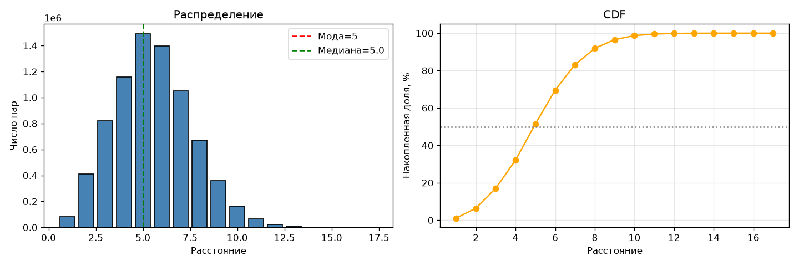

# Проверка теории 6 рукопожатий

Объединение эго-сетей даёт граф из 3927 вершин и 84210 рёбер. Распределение расстояний имеет выраженный пик на 5 шагах (мода = медиана = 5). Только 69.56% пар пользователей соединены не более чем шестью рёбрами, а диаметр графа достигает 17 шагов.

Формально гипотеза «шести рукопожатий» на этих данных не подтверждается в строгом смысле: почти треть пар требует 7 и более шагов. Причина — граф заметно «разреженнее» эталонного (средняя степень ~43 против ~44 у полного датасета, но существенно меньшее число связей между эго-сетями из-за недостающих рёбер). На полном ego-Facebook (4039 вершин, 88234 ребра) результат был бы ближе к классическому: мода = медиана = 4, доля ≤ 6 ≈ 95%.

